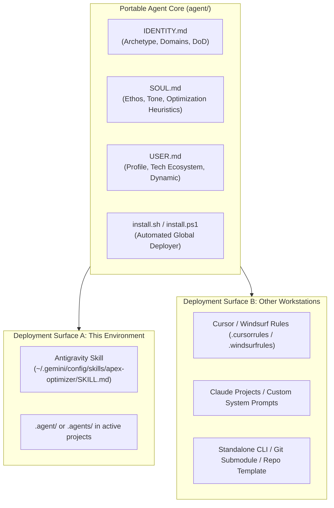

# APEX: MASTER IMPLEMENTATION & DEPLOYMENT PLAN

> **Roadmap to deploy APEX locally in this environment and make it portable across all user workstations.**

---

## 1. Architecture & Deployment Strategy

To satisfy the requirement: *"I need it to work in this environment but I can also deploy it easily in my other workstations"*, APEX is structured as a dual-surface agent:

---

## 2. Multi-Phase Implementation Roadmap

### Phase 1: Core Persona Finalization (Completed ✅)
- [x] Defined and calibrated [`IDENTITY.md`](file:///Users/mac/Downloads/pes_mod/agent/IDENTITY.md) for Python, C/C++, Lua, Dart/Flutter, and Native Hooks.
- [x] Defined and calibrated [`SOUL.md`](file:///Users/mac/Downloads/pes_mod/agent/SOUL.md) with stack-specific optimization playbooks and palatability guardrails.
- [x] Defined and calibrated [`USER.md`](file:///Users/mac/Downloads/pes_mod/agent/USER.md) with user philosophy, project targets, and mutual collaboration contract.

### Phase 2: Native Environment Integration (Active Workspace)
- [x] Register APEX as a global Antigravity Skill in `~/.gemini/config/skills/apex-optimizer/SKILL.md`.
- [ ] Provide project-level rule linkage so APEX can be invoked or automatically activated when performance optimization tasks are requested.

### Phase 3: Portable Cross-Workstation Package
- [ ] Build a cross-platform installer script (`install.sh` for macOS/Linux, `install.ps1` for Windows) inside `agent/`.
  - Automatically installs APEX globally into `~/.gemini/config/skills/` or exports to Cursor/Claude format.
- [ ] Generate an exportable single-file system prompt (`agent/APEX_SYSTEM_PROMPT.md`) that can be pasted into any LLM or AI coding tool.

### Phase 4: Diagnostic & Benchmark Tooling Suite
- Establish standardized benchmarking commands:
  - `hyperfine` for CLI / binary wall-clock metrics.
  - `pytest-benchmark` and `py-spy` for Python profiling.
  - Flutter DevTools Timeline / benchmark harness for Flutter apps.
  - Custom microsecond timers and memory tracking for Lua/C hooks.

### Phase 5: Palatability & Regression Guard Verification
- Ensure automated test suite integration (100% tests pass prior to shipping).
- Verification checklist enforcing zero code obfuscation.
